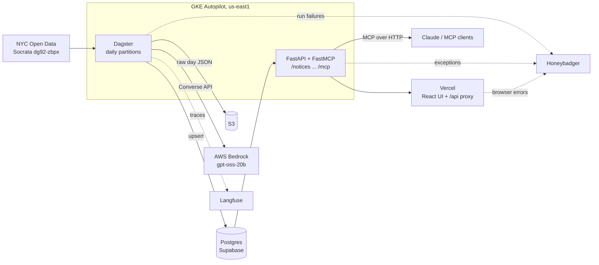

# city-records

NYC publishes 15-40 procurement notices every business day in the City Record: awards, solicitations, intents to award, hearings. The public dataset is a raw table with free-text descriptions that nobody reads. city-records pulls each day's notices from NYC Open Data (dataset `dg92-zbpx`, via the Socrata API), enriches them with a small LLM (what is being bought, product category, software/renewal flags, a plain-English summary), resolves vendor names to canonical vendors, and serves the result through a search dashboard and an MCP server, so people and agents can ask questions like "which agencies are buying software this month?".

Live demo (taken down to cut cost): https://city-records-one.vercel.app

## Architecture



| Component | Location | Role |
|---|---|---|
| Pipeline | `pipeline/` | Dagster project `cityrecords`; assets, schedule, sensor and resources under `defs/`, pure helpers beside it, Alembic migrations |
| API | `api/` | FastAPI REST plus FastMCP server in one process, read-only against Postgres |
| Web | `web/` | Vite + React + Tailwind + Recharts; `web/api/proxy.js` is the Vercel function that injects the API key |
| Infra | `infra/` | Cluster, secret and deploy scripts, Dagster Helm values, API manifests |
| CI/CD | `.semaphore/` | Tests on every push; manual promotion deploys images, Helm release, API and dashboard together |
| Postgres | Supabase | App tables in schema `cr`, Dagster metadata in `public` |
| S3 | AWS | Raw per-day Socrata JSON (`notices/<date>.json`) |
| Bedrock | AWS | `openai.gpt-oss-20b-1:0` via the Converse API |
| Langfuse | cloud | One generation per Bedrock call with model, parameters, prompt, tokens and cost |
| Honeybadger | cloud | One project per component; faults open labelled GitHub issues |

## How it works

Partitions are daily from 2026-09-01. `daily_schedule` (`0 14 * * 1-5` UTC) runs the previous business day; `daily_job` materializes three assets in order:

1. **`raw_notices`** pulls the day's notices for the procurement-related sections, writes the untouched rows to S3, strips HTML, hashes title + description and upserts into `cr.notices` by `request_id`.
2. **`enriched_notices`** picks notices with no enrichment or a changed content hash or prompt version, and calls Bedrock with title, description and a few structured fields. The reply is validated with Pydantic after repairing two known gpt-oss quirks, with one corrective retry. Results go to `cr.enrichments`. The asset check `enrichment_coverage` fails the run if more than 5% of the day is left unenriched. Every call is traced in Langfuse with cost (about $0.00007 per notice).
3. **`vendors`** normalizes raw vendor names, fuzzy-matches them against known vendors (rapidfuzz, threshold 92), inserts new ones and sets `vendor_id` on the notices.

Re-running a partition is safe: notices are upserted, unchanged enrichments are skipped (no LLM cost), vendors only touches notices without a `vendor_id`. `PROMPT_VERSION` doubles as the Dagster `code_version`, so bumping it marks the asset stale and re-enriches on the next run. `run_failure_sensor` reports failed runs to Honeybadger.

### Data model

Schema `cr`, created by `pipeline/migrations`:

| Table | Key columns |
|---|---|
| `cr.notices` | `request_id` (PK), `published_on`, `section`, `notice_type`, `agency`, `category`, `title`, `description`, `contract_amount`, `vendor_name_raw`, `vendor_id`, `content_sha256`, `s3_key`, generated `search` tsvector (GIN) |
| `cr.enrichments` | `request_id` (PK, FK), `what_is_bought`, `product_category`, `is_software`, `is_renewal`, `summary`, `keywords[]`, `confidence`, `model`, `prompt_version`, `content_sha256`, `enriched_at` |
| `cr.vendors` | `id`, `name`, `normalized_name` (unique), `address`, `first_seen` |

Enrichments live in their own table because source data and derived data have different lifecycles: notices mirror the source and can be reloaded any time; enrichments are regenerable and replaced when the prompt or model changes. Storing `model`, `prompt_version` and `content_sha256` makes each enrichment attributable and lets the pipeline tell when one is out of date.

## API

Every route except `/health` requires the `x-api-key` header.

| Route | Description |
|---|---|
| `GET /notices` | Search and filter: `q` (ranked full text), `agency`, `notice_type`, `category`, `product_category`, `is_software`, `min_amount`, `from`, `to`, `limit`, `offset` |
| `GET /notices/{id}` | One notice with enrichment, vendor and source URL |
| `GET /vendors/{id}` | Vendor with its notices |
| `GET /stats` | Totals, open solicitations, awarded USD, weekly series by type, top agencies, product categories |
| `GET /filters` | Distinct values for the UI filters |
| `GET /health` | Liveness with a database check |
| `/mcp` | MCP over streamable HTTP; tools `search_notices`, `get_notice`, `vendor_history`, `stats` |

```bash
claude mcp add --transport http city-records http://<API_IP>/mcp --header "x-api-key: <key>"
```

## Local development

Prerequisites: Python 3.12, [uv](https://docs.astral.sh/uv/), Node with pnpm, a Postgres database (Supabase works), AWS credentials with S3 and Bedrock access.

```bash
cp .env.example .env                        # fill in values; see the table below

cd pipeline && uv sync
uv run alembic upgrade head                 # creates schema cr
DAGSTER_HOME=$PWD uv run dg dev             # http://localhost:3000
uv run dg launch --assets '*' --partition 2026-10-09

cd api && uv sync
uv run uvicorn cityrecords_api.main:app --reload     # http://localhost:8000

cd web && pnpm install && pnpm dev          # http://localhost:5173, /api proxied to :8000
```

Tests:

```bash
cd pipeline && uv run dg check defs && uv run pytest   # fakes for Socrata, S3 and Bedrock
cd api && uv run pytest -m "not integration"
cd web && pnpm lint && pnpm build
```

### Environment variables

| Variable | Used by | Purpose |
|---|---|---|
| `GCP_PROJECT_ID`, `GCP_REGION` | infra scripts | GCP project and region |
| `AWS_ACCESS_KEY_ID`, `AWS_SECRET_ACCESS_KEY`, `AWS_REGION` | pipeline | S3 and Bedrock access |
| `S3_BUCKET` | pipeline | Bucket for raw day JSON |
| `BEDROCK_MODEL_ID` | pipeline | `openai.gpt-oss-20b-1:0` |
| `DATABASE_URL` | pipeline, Dagster | Supabase pooler, session mode |
| `DATABASE_POOL_URL` | API | Supabase pooler, transaction mode |
| `SOCRATA_APP_TOKEN` | pipeline | Optional; raises Socrata rate limits |
| `HONEYBADGER_API_KEY_PIPELINE`, `_BACKEND`, `_FRONTEND` | pipeline, API, web | One Honeybadger project per component |
| `LANGFUSE_PUBLIC_KEY`, `LANGFUSE_SECRET_KEY`, `LANGFUSE_HOST` | pipeline | LLM tracing, skipped when unset |
| `API_KEY` | API, Vercel | Shared secret for the `x-api-key` header |
| `API_HOST` | Vercel | Base URL of the GKE service |
| `VITE_API_URL`, `VITE_HONEYBADGER_API_KEY` | web | See `web/.env.example` |

## Deployment

Prerequisites: `gcloud`, `kubectl`, `helm`, Docker with buildx, a filled `.env`.

```bash
infra/create-cluster.sh    # APIs, Artifact Registry, GKE Autopilot cluster; idempotent
infra/deploy.sh            # build + push images (tag = git SHA), secrets, Helm upgrade, API manifests
kubectl -n app get svc api                                              # API external IP
kubectl -n dagster port-forward svc/dagster-dagster-webserver 3000:80   # Dagster UI
```

Dagster runs with `K8sRunLauncher`, so every run is its own pod, and keeps its metadata in Supabase. The API is a Deployment behind a LoadBalancer; the browser never talks to it directly, the Vercel function does and adds the key. Vercel is linked to this repo (root `web`): pull requests get previews, and production deploys only through the Semaphore promotion, which also builds the images, upgrades the Helm release and rolls the API so everything ships together.

Teardown: `gcloud container clusters delete city-records --region us-east1` and pause the Vercel project.

## Design decisions

- **Postgres full-text search, not Elasticsearch.** A few hundred rows a month; a generated tsvector with a GIN index gives ranked search with no extra service. Cost: no typo tolerance or semantic matching.
- **gpt-oss-20b, not a larger model.** Short schema-validated extraction on every notice; a small model is cheap and fast enough, and confidence is stored per row. Cost: it is a reasoning model, so replies carry a reasoning block, and quality is not yet measured against a golden set.
- **S3 from GKE across clouds.** Bedrock and the bucket live in one AWS account, which keeps IAM simple. Cost: a static key to rotate; Workload Identity Federation would remove it.
- **LoadBalancer plus the Vercel proxy, not Ingress with TLS.** The API key stays server-side. Cost: Vercel and MCP clients reach the cluster over plain HTTP. Fine for public data on a demo.
- **Scripts, not Terraform.** One cluster and three idempotent scripts. Cost: no drift detection. Revisit if a second environment appears.
- **Dagster OSS with a private UI, not Dagster+.** Reachable only by port-forward, so no public auth surface. Cost: we run the daemon and webserver ourselves and use Honeybadger for alerting.
