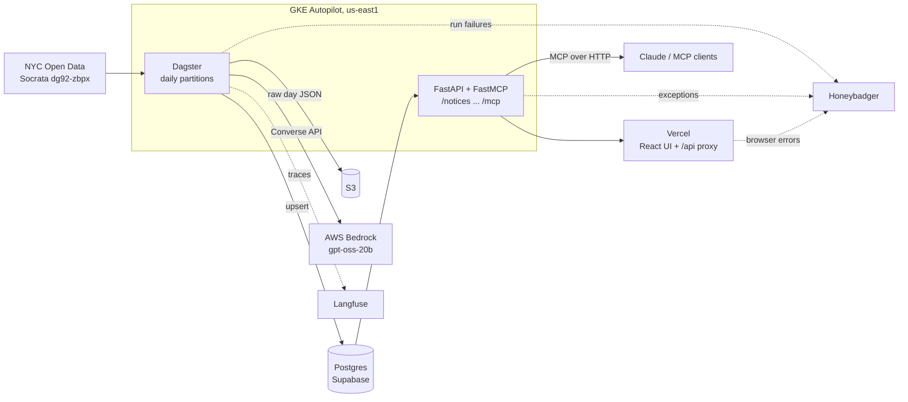

# city-records

NYC publishes 15-40 procurement notices every business day in the City Record: awards, solicitations, intents to award, hearings. The public dataset is a raw table with free-text descriptions that nobody reads. city-records pulls each day's notices from NYC Open Data (dataset `dg92-zbpx`, City Record Online, via the Socrata API; it is refreshed automatically on weekdays), enriches them with a small LLM (what is being bought, category, software/renewal flags, a plain-English summary), resolves vendor names to canonical vendors, and serves the result through a search UI and an MCP server so people and agents can ask questions like "which agencies are buying software this month?".

Live UI: https://city-records-one.vercel.app

Current data (verified): 2026-10-09 had 24 notices, 24 enrichments and 12 vendors, with mean enrichment confidence 0.94. For 2026-09-01 to 2026-10-09 there are 784 notices across the tracked sections, 463 of them procurement (318 awards, 100 solicitations, 45 intents to award), with about $2.8B in awards.

## Architecture



| Component | Location | Role |
|---|---|---|
| Pipeline | `pipeline/` | Dagster project (`cityrecords`): `defs/` holds assets, automation and resources and is autoloaded by `definitions.py`; pure helpers (`enrich.py`, `text.py`, `vendors_util.py`) sit beside it; Alembic migrations |
| API | `api/` | FastAPI REST plus FastMCP server in one process, read-only against Postgres |
| Web | `web/` | Vite + React (JavaScript) + Tailwind + Recharts; `web/api/proxy.js` is the Vercel proxy |
| Infra | `infra/` | Cluster/secret/deploy scripts, Dagster Helm values, API manifests (`infra/k8s`) |
| Postgres | Supabase | App tables in schema `cr`, Dagster metadata in `public` |
| S3 | AWS | Raw per-day Socrata JSON (`notices/<date>.json`) |
| Bedrock | AWS | `openai.gpt-oss-20b-1:0` via the Converse API |
| Langfuse | cloud | One trace per notice, one *generation* per Bedrock call with model, parameters, system prompt, tokens and cost; prompt registered in prompt management |
| Honeybadger | cloud | Pipeline failures, API exceptions, frontend errors |

## Data flow per partition

Partitions are daily, starting 2026-09-01. Job `daily_job` materializes the three assets of one partition in order:

1. `raw_notices`: queries Socrata for notices whose `start_date` falls on the partition day, restricted to the sections Procurement, Public Comment on Contract Awards, Contract Award Hearings, and Public Hearings and Meetings (paged, 5000 rows per request). Writes the untouched rows to S3 at `notices/<date>.json`, strips HTML from the description, computes `content_sha256` over title + description, and upserts into `cr.notices` on `request_id`. Metadata: `rows`, `new`, `changed`, `s3_key`.
2. `enriched_notices`: selects the day's notices that have no enrichment, or whose enrichment has a different `content_sha256` or `prompt_version`. Calls Bedrock (4 worker threads) with title, description and a few structured fields. The Converse response of this reasoning model has a reasoning block first; the code takes the first block with a `text` key. The JSON is validated with Pydantic (`Enrichment`); two systematic gpt-oss quirks (a stray quote after a bare number, a trailing comma) are repaired before validation, and an invalid reply gets one corrective retry with a larger token budget. Calls request `reasoning_effort: low`, because at the default effort the model sometimes spent the whole budget thinking and never emitted the JSON. Results are upserted into `cr.enrichments`. Langfuse traces every call when its keys are set: the `enrich_notice` span is the parent and each Bedrock attempt is a generation (`bedrock.converse`) carrying the model id, `model_parameters`, the full system and user messages, `usage_details` from the Converse response and a link to the `enrich-notice` prompt in Langfuse prompt management. Cost is computed by Langfuse from a project-level model definition matching `openai.gpt-oss-20b*` (US on-demand $0.07 per 1M input and $0.30 per 1M output tokens, as published by Bedrock price trackers; the AWS pricing page did not show a US on-demand row when checked). The code's `SYSTEM_PROMPT` remains the source of truth; the Langfuse prompt is for attribution and diffing, and a new version should be created there when the text changes. Metadata: `calls`, `failed`, `mean_confidence`, `notices`, `unenriched`. Individual failures are logged and skipped; the asset raises only if every call failed. The asset check `enrichment_coverage` fails when more than 5% of the day's notices are left without an enrichment, so partial failures are visible rather than hidden behind a green run. Run config `only_missing: true` restricts a run to notices with no enrichment row, which is how gaps are backfilled without re-enriching whole days.
3. `vendors`: normalizes `vendor_name_raw` (lowercase, punctuation and suffixes such as inc/llc/corp removed), matches against known vendors with rapidfuzz `token_set_ratio` at threshold 92, inserts new vendors, and sets `cr.notices.vendor_id`. Metadata: `new`, `matched`.

Idempotency: re-running a partition is safe. Notices are upserted by `request_id`; enrichment is skipped when the content hash and prompt version are unchanged (so a rerun costs no LLM calls); vendors only touches notices without a `vendor_id`. The prompt version (`PROMPT_VERSION = "v2"`) is also the Dagster `code_version` of `enriched_notices`, so bumping it marks the asset as stale in the UI and makes the next run re-enrich everything.

## Data model

Created by `pipeline/migrations/versions/0001_init.py` in schema `cr`.

| Table | Key columns |
|---|---|
| `cr.notices` | `request_id` (PK, from the source), `published_on`, `end_date`, `section`, `notice_type`, `agency`, `category`, `title`, `description` (HTML stripped), `selection_method`, `pin`, contact fields, `contract_amount`, `vendor_name_raw`, `vendor_id` (FK), `event_date`, `content_sha256`, `s3_key`, generated `search` tsvector |
| `cr.enrichments` | `request_id` (PK, FK to notices), `what_is_bought`, `product_category` (fixed list of 20), `is_software`, `is_renewal`, `summary`, `keywords[]`, `confidence`, `model`, `prompt_version`, `content_sha256`, `enriched_at` |
| `cr.vendors` | `id`, `name`, `normalized_name` (unique), `address`, `first_seen` |

`search` is a stored generated column over title, description, agency and vendor, with a GIN index. Other indexes: `published_on`, `agency`, `notice_type`, `vendor_id`, and on enrichments `product_category` and `is_software`.

Why enrichment is a separate table: source data and derived data have different lifecycles. The notices table mirrors the source and can be reloaded at any time; enrichments are expensive, regenerable, and replaced when the prompt or model changes. Keeping them apart lets us re-enrich without touching source rows and see which notices lack enrichment (left join). `model`, `prompt_version` and `content_sha256` are stored so each enrichment is attributable and reproducible, and so the pipeline can tell when one is out of date (notice text changed, or prompt bumped).

## Local development

Prerequisites: Python 3.12, [uv](https://docs.astral.sh/uv/), Node with pnpm, a Postgres database (a Supabase project works), AWS credentials with S3 and Bedrock access (model access enabled for `openai.gpt-oss-20b-1:0`).

```bash
cp .env.example .env     # fill in values; .env is git-ignored. See the env table below.

# Pipeline
cd pipeline
uv sync
uv run alembic upgrade head                 # creates schema cr
DAGSTER_HOME=$PWD uv run dg dev             # UI at http://localhost:3000
uv run dg launch --assets '*' --partition 2026-10-09

# API (second terminal)
cd api
uv sync
uv run uvicorn cityrecords_api.main:app --reload     # http://localhost:8000

# Web (third terminal)
cd web
pnpm install
pnpm dev                                     # http://localhost:5173, /api proxied to :8000
```

`pipeline/src/cityrecords/definitions.py` loads the repo-root `.env` automatically in development and autoloads everything under `cityrecords/defs/` (the `dg scaffold` layout). `uv run dg check defs` validates the code location and runs in CI before the tests; `tests/test_definitions.py` asserts the expected assets, job, schedule, sensor and resource bindings. The `Postgres` resource owns the SQLAlchemy engine for the run (`setup_for_execution`/`teardown_after_execution`) and assets borrow `db.connection()` or `db.transaction()`; they never see the engine. `DAGSTER_HOME=$PWD` makes Dagster read `pipeline/dagster.yaml`, which stores run metadata in Postgres. In dev the web app calls `/api/*` through the Vite proxy; if `VITE_API_KEY` is set it is sent as `x-api-key` (the value is visible in the browser, so use it only locally).

Tests:

```bash
cd pipeline && uv run pytest     # fakes for Socrata, S3 and Bedrock; fixture in tests/fixtures
cd api && uv run pytest          # tests marked "integration" need a real database
cd web && pnpm lint
```

## Deployment

Prerequisites: `gcloud`, `kubectl`, `helm`, Docker with buildx, a filled `.env`. Project and registry names are set in the scripts.

```bash
infra/create-cluster.sh    # enables APIs, Artifact Registry repo, GKE Autopilot cluster "city-records" (us-east1); idempotent
infra/secrets.sh           # k8s secrets from .env (never prints values)
infra/deploy.sh            # build + push images (tag = git short SHA), helm upgrade Dagster, apply API manifests
infra/deploy.sh --skip-build
```

`deploy.sh` builds `pipeline` and `api` images for linux/amd64, runs `secrets.sh`, installs Dagster with the official Helm chart (`infra/dagster-values.yaml`), applies `infra/k8s` (namespaces `dagster` and `app`, API Deployment and a LoadBalancer Service on port 80), and waits for rollouts. Dagster uses `K8sRunLauncher`, so every run is its own pod; the user-code deployment runs `dagster code-server` for `cityrecords.definitions`. Dagster's own metadata lives in the Supabase database (the chart's bundled Postgres is disabled).

Secrets created: `pipeline-env` and `dagster-postgresql-secret` (namespace `dagster`), `api-env` (namespace `app`).

Access:

```bash
kubectl -n app get svc api                                     # EXTERNAL-IP of the API
kubectl -n dagster port-forward svc/dagster-dagster-webserver 3000:80   # Dagster UI at localhost:3000
kubectl -n app logs deploy/api
```

Frontend (Vercel project with root directory `web`, framework Vite, build `pnpm build`, output `dist`): `web/vercel.json` rewrites everything except `/api/*` to `index.html`; `/api/*` is rewritten to the serverless function `web/api/proxy.js` (an explicit rewrite, because a filesystem catch-all only matched single-segment paths in production), which forwards to `API_HOST` and adds the `x-api-key` header server-side. Set `API_HOST` and `API_KEY` as Vercel environment variables, and leave `VITE_API_KEY` unset in production.

Connect Claude Code to the MCP server:

```bash
claude mcp add --transport http city-records http://<API_IP>/mcp --header "x-api-key: <key>"
```

Tools: `search_notices`, `get_notice`, `vendor_history`, `stats`.

### Environment variables

| Variable | Used by | Purpose |
|---|---|---|
| `GCP_PROJECT_ID`, `GCP_REGION` | infra scripts | GCP project and region (`us-east1`) |
| `AWS_ACCESS_KEY_ID`, `AWS_SECRET_ACCESS_KEY`, `AWS_REGION` | pipeline | S3 and Bedrock access (static key) |
| `S3_BUCKET` | pipeline | Bucket for raw day JSON |
| `BEDROCK_MODEL_ID` | pipeline | `openai.gpt-oss-20b-1:0` |
| `DATABASE_URL` | pipeline, Dagster | Supabase pooler, session mode, port 5432 |
| `DATABASE_POOL_URL` | API | Supabase pooler, transaction mode, port 6543 |
| `SOCRATA_APP_TOKEN` | pipeline | Optional; raises Socrata rate limits |
| `HONEYBADGER_API_KEY` | pipeline, API | Failure reporting (skipped when unset) |
| `LANGFUSE_PUBLIC_KEY`, `LANGFUSE_SECRET_KEY`, `LANGFUSE_HOST` | pipeline | LLM tracing (skipped when keys unset) |
| `API_KEY` | API, Vercel | Shared secret for the `x-api-key` header |
| `API_HOST` | Vercel | Base URL of the GKE service, e.g. `http://<API_IP>` |
| `VITE_API_URL`, `VITE_HONEYBADGER_API_KEY` | web | See `web/.env.example` |

The Supabase direct host is IPv6-only, so both the pipeline and the API connect through the pooler: session mode for Dagster (it needs session features), transaction mode for the API. Transaction mode cannot hold server-side prepared statements, so the API engine sets `prepare_threshold=None`.

## API

FastAPI and FastMCP run in one process on port 8000. Every route except `/health` requires the `x-api-key` header (constant-time compare; `OPTIONS` is exempt for CORS).

| Route | Description |
|---|---|
| `GET /notices` | Search and filter: `q` (web-style full text via `websearch_to_tsquery`, ranked), `agency`, `notice_type`, `category`, `product_category`, `is_software`, `min_amount`, `from`, `to`, `limit` (max 100), `offset` |
| `GET /notices/{id}` | One notice with enrichment, vendor and a `source_url` |
| `GET /vendors/{id}` | Vendor with its notices |
| `GET /stats` | Totals, open solicitations, awarded USD, weekly series by type, top 10 agencies, product-category counts |
| `GET /filters` | Distinct values for the UI filters |
| `GET /health` | Liveness, includes a database check |
| `/mcp` | MCP over streamable HTTP (stateless) |

Unhandled exceptions are reported to Honeybadger and return a generic 500.

## Operations

- Schedule: `daily_schedule`, `0 14 * * 1-5` UTC (default status running). It requests the previous business day: Monday runs Friday's partition, other days run the previous calendar day. The `run_key` equals the partition key, so a duplicate tick does not launch a second run.
- Backfill: in the Dagster UI, open the asset graph, select the assets, choose Materialize and pick a partition range. Or via the GraphQL API / `dg launch --assets '*' --partition <date>` for a single day. Backfills are safe to repeat because of the idempotency rules above. The run coordinator allows 2 concurrent runs.
- Retries: `enriched_notices` has a `RetryPolicy` of 3 retries with exponential backoff starting at 15 seconds (the asset raises if every Bedrock call in a run failed). Bedrock calls also use botocore retries (3 attempts). Other assets are not retried by policy.
- Failures: `run_failure_sensor` fires when a run fails, which is after asset retries are exhausted, and sends a `DagsterRunFailure` to Honeybadger with job, run id, partition and a Dagster URL (set `DAGSTER_URL` to make the link useful). Without `HONEYBADGER_API_KEY` it only logs.
- Cost controls: a small model (20B), input limited to the notice's title, description and a handful of structured fields (description truncated at 6000 characters), `max_tokens` of 600 on the first attempt, enrichment skipped when the content hash and prompt version are unchanged, and tokens and cost per call visible in Langfuse (about $0.00007 per notice, so a 30-notice day costs well under a cent).
- What to look at: Dagster UI for runs, partition status and per-asset metadata (`new`, `changed`, `mean_confidence`, `failed`, `unenriched`) and the `enrichment_coverage` check; Langfuse for LLM traces; Honeybadger for failures and API/browser errors; GKE logging for pod logs.
- Gone and stale: nothing is deleted. If a notice disappears from the source it simply stops being updated and remains in `cr.notices`; there is no tombstone yet. A solicitation is treated as no longer open when its `end_date` is in the past (see `open_solicitations` in `/stats`). An enrichment is stale when its `content_sha256` differs from the notice or its `prompt_version` differs from the current one; the next run for that partition (or a backfill) refreshes it. Dagster marks `enriched_notices` stale in the UI when `PROMPT_VERSION` changes.

## Design decisions and tradeoffs

- Postgres full-text search instead of Elasticsearch. Volume is a few hundred rows a month; a generated tsvector with a GIN index gives ranked search with no extra service to run. Cost: no typo tolerance or semantic matching (see embeddings below).
- gpt-oss-20b instead of a larger model. The task is short structured extraction from a few paragraphs, validated by a schema, and it runs on every notice. A small model is cheap and fast enough; confidence is stored and averaged per run (0.94 on 2026-10-09). Cost: it is a reasoning model, so replies carry a reasoning block and need a larger token budget on retry; quality is not yet measured against a golden set.
- S3 from GKE across clouds. The raw payload store is S3 because Bedrock and the buckets live in AWS, and a single AWS account keeps IAM simple. Access uses a static IAM key in a k8s secret. Tradeoff: a long-lived credential, cross-cloud egress, and a key to rotate; Workload Identity Federation would remove the key (next steps).
- LoadBalancer plus the Vercel proxy instead of Ingress with TLS. The browser never talks to the GKE service; the Vercel function does, and it holds the API key, so the key is not exposed to the client. Tradeoff: the hop between Vercel and the cluster, and MCP clients, use plain HTTP with the key in a header. Acceptable for public data on a demo, not for anything sensitive.
- No Terraform. There is one cluster, one namespace pair and three scripts; the scripts are idempotent and readable. The cost is no drift detection or reviewable plan. Revisit if a second environment appears.
- Dagster OSS with a private UI instead of Dagster+. The UI is reachable only by `kubectl port-forward`, so there is no public auth surface to harden; the cost is that we run the daemon, webserver and upgrades ourselves, and have no hosted alerting (hence Honeybadger).
- One run pod per run (`K8sRunLauncher`). Isolation and Autopilot-friendly scaling, at the cost of pod start-up time for each run.

## Not done yet

- Golden-set evaluation of the enrichment and a CI gate on it, so prompt or model changes are measured before shipping.
- CI/CD: `.semaphore/semaphore.yml` runs three parallel blocks on every push (pipeline: `dg check defs` + pytest; API: unit pytest; web: lint + build) with uv and pnpm caches. Deploy is a manual promotion to `.semaphore/deploy.yml`, which builds and pushes both images, applies secrets, upgrades the Dagster Helm release and rolls the API; it needs the Semaphore secrets `city-records-gcp` and `city-records-app`.
- Ingress with a Google-managed certificate for the API (HTTPS for MCP clients).
- Workload Identity Federation for AWS instead of a static key.
- A second source: agency solicitation pages, which are not in the City Record.
- Slack alerts alongside Honeybadger.
- Embedding-based search to complement full text.
- Handling of notices removed from the source (tombstones).
